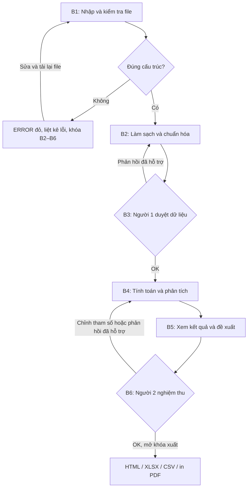

# BRD — CodeKit Dashboard V14 / AI Data Agent

| Hạng mục | Hiện trạng |
|---|---|
| Phiên bản giao diện và luồng | 19.6 |
| Cập nhật theo yêu cầu | 12/11/2026 |
| Mã nguồn | `index.html`, `script.js`, `dashboard.js`, `explorations.js`, `report.js`, `style.css`, `ui.css` |
| Kiến trúc | HTML/CSS/JavaScript chạy trong trình duyệt; thư viện đặt tại `assets/` |
| Đầu vào | CSV, XLSX, XLS; chọn sheet và xem trước trước khi nhập |
| Đầu ra sau nghiệm thu | HTML, XLSX, CSV; PDF qua hộp thoại in |

Tài liệu này mô tả hiện trạng sau khi đối chiếu quy trình 6 bước do người dùng cung cấp. Các cơ chế tự sinh khóa thiếu ở B1 của phiên bản trước đã được loại bỏ.

## 1. Quy trình bắt buộc

Phản hồi chưa được hỗ trợ giữ nguyên dữ liệu/tham số, hiển thị thông báo và chặn phê duyệt cho tới khi xử lý hoặc xóa nội dung để hủy yêu cầu. Không được thông báo đã thực hiện một yêu cầu chưa xử lý.

## 2. B1 — Nhập file, đối soát đầu vào

Năm cột cốt lõi:

| Trường | Khóa nội bộ |
|---|---|
| Mã khách hàng | `customer_id` |
| Mã đơn hàng | `order_id` |
| Ngày giao hàng | `date` |
| Doanh thu | `revenue` |
| Trạng thái | `status` |

- Kiểm tra phần mở rộng, đọc nội dung, từ chối file rỗng, lỗi cấu trúc CSV, tiêu đề trùng hoặc ánh xạ không rõ ràng.
- Khớp tiêu đề chính xác theo nhãn/alias sau chuẩn hóa dấu, hoa/thường và khoảng trắng. Không khớp chỉ vì chứa một phần tên khóa.
- Mã khách hàng/mã đơn không được trống. Cột ngày, doanh thu, trạng thái phải tồn tại; ô thiếu bên trong được xử lý hoặc đánh dấu tại B2.
- Người dùng có thể thêm cột bắt buộc; không xóa được 5 cột cốt lõi. Đóng cấu hình chưa lưu không làm thay đổi dữ liệu. Lưu thay đổi sẽ kiểm tra lại bảng hiện tại.
- File lỗi hiển thị chữ ERROR đỏ lớn và chi tiết lỗi. Chỉ có tải mẫu tiêu đề và tải lại file đã sửa. Không tự ghép/sinh khóa để vượt B1.
- Nhập file mới hủy tác vụ cũ và thu hồi toàn bộ phê duyệt. File mới lỗi không được dùng kết quả của file cũ để đi tiếp. Lượt đọc file cũ hoàn tất muộn không được ghi đè file mới.

## 3. B2 — Làm sạch

- Loại trùng theo mã đơn đã cắt khoảng trắng, giữ bản ghi xuất hiện đầu tiên.
- Cắt khoảng trắng của các ô chuỗi; chuẩn hóa tiền và ngày.
- Doanh thu không hợp lệ hoặc không dương được thay bằng trung vị các giá trị dương có trong nguồn đang xử lý. Nếu không có giá trị hợp lệ, dùng 0; đây là quy tắc hiện có, cần thay đổi nếu nghiệp vụ có đơn miễn phí hoặc doanh thu âm.
- Ngày serial Excel và ngày ISO/ngày-tháng-năm hợp lệ chuyển sang `dd/mm/yyyy`. Ngày thiếu hoặc không tồn tại để trống, ghi rõ trong nhật ký; không bịa một ngày cố định.
- Trạng thái thiếu chuyển `Processing`; trạng thái nhận diện được chuẩn hóa; trạng thái lạ giữ lại để kiểm duyệt và không tự tính là hoàn tất.
- Hiển thị tiến trình, số dòng, số thao tác và nhật ký. Chỉ số chất lượng là tỷ lệ dòng đủ trường bắt buộc sau xử lý, không phải độ tin cậy mô hình.
- Nút B3 khóa trong lúc làm sạch. Lưu một bản sạch ban đầu để khôi phục ở B3.

## 4. B3 — Người kiểm duyệt 1

- Bảng có tìm kiếm, bộ lọc trạng thái, phân trang 20 dòng và xóa dòng. Hiển thị tất cả cột và cuộn ngang; cho sửa trực tiếp từng ô.
- Nhánh chưa OK: nhập phản hồi, quay về B2 làm sạch lại bản làm việc hiện tại, rồi tự trở về B3 với bảng cập nhật và lịch sử phản hồi.
- Hỗ trợ bỏ/chỉ giữ trạng thái; ngưỡng doanh thu `<`, `<=`, `>`, `>=`; kiểm tra trùng; viết hoa tên khách hàng; bỏ/chỉ giữ từ khóa đặt trong dấu ngoặc kép.
- Tách nhiều lệnh bằng dấu `;`, xuống dòng hoặc “và”. Toàn bộ nhóm lệnh được kiểm tra trước khi cập nhật; lệnh chưa hỗ trợ không được áp dụng một phần.
- Ví dụ: `Bỏ đơn Canceled; Chỉ giữ đơn doanh thu >= 500`, `Chỉ giữ "Hà Nội"`, `Viết hoa tên khách hàng`.
- Phê duyệt phải áp dụng cho toàn bộ bảng làm việc, không chỉ các dòng đang tìm kiếm. Bảng 0 dòng không được duyệt; có thể khôi phục bản sạch ban đầu.
- Sửa/xóa/khôi phục dữ liệu làm mất phê duyệt và kết quả phân tích cũ. Phải xác nhận lại B3 trước khi sang B4.

## 5. B4 — Tính toán và phân tích

- Màn hình riêng, chỉ chạy sau phê duyệt B3.
- Tính doanh thu, lợi nhuận ước tính theo biên được chọn, số đơn, AOV, khách hàng, tỷ lệ quay lại, trạng thái, Top 5 và xu hướng.
- Sinh đề xuất theo số liệu và trọng tâm `balanced`, `revenue`, `retention`, `efficiency`.
- Chỉ mở B5 khi phép tính hoàn tất thành công; nếu lỗi hiển thị thông báo và nút thử lại.

## 6. B5 — Kết quả

- Màn hình riêng gồm KPI, biểu đồ tài chính, biểu đồ trạng thái, Top 5 và đề xuất kinh doanh.
- Gom nhóm biểu đồ theo ngày/tuần/tháng. Chế độ ngày có thể hiển thị 16 mốc gần nhất; KPI phản ánh toàn bộ kỳ đã chọn.
- Lợi nhuận là ước tính theo biên giả định. Các mục tiêu tăng trưởng 15%/18% là kịch bản kế hoạch, không phải dự báo đã được kiểm chứng.
- Cần mở B5 xem kết quả của lượt phân tích hiện tại trước khi sang B6.

## 7. B6 — Người kiểm duyệt cuối

- Nhánh chưa OK: đổi biên lợi nhuận 0–100%, cách tính đơn hủy, trọng tâm đề xuất hoặc nhập phản hồi được hỗ trợ; chạy lại B4 rồi xem B5, quay lại B6.
- Ví dụ: `Biên lợi nhuận 40%; Loại đơn hủy; Tập trung VIP`.
- Nhánh OK: nhấn **Xác nhận OK & mở khóa xuất kết quả**. Sau đó mới xuất HTML/XLSX/CSV/in PDF.
- Kiểm soát cả ở nút và hàm xuất; bấm nhảy bước không bỏ qua được điều kiện duyệt.
- Đổi dữ liệu, tham số, kỳ phân tích, cách gom nhóm hoặc nhập phản hồi thu hồi nghiệm thu. Tham số thay đổi phải được chạy lại trước khi duyệt.
- HTML xuất gồm KPI, xếp hạng, đề xuất, nguồn dữ liệu, kỳ báo cáo và ghi chú giả định. XLSX/CSV chứa dữ liệu sạch trong kỳ đang chọn, gồm mọi trạng thái; loại trừ đơn hủy là chính sách tính KPI được ghi trong HTML.

## 8. Slicer thời gian trên các dashboard

- Có tại Tổng quan và Kết quả phân tích, với trạng thái lọc riêng.
- Chọn toàn bộ thời gian, 7 ngày/30 ngày cuối dữ liệu, tháng cuối dữ liệu, hoặc nhập từ ngày/đến ngày rồi áp dụng.
- Mốc chọn nhanh tính theo ngày hợp lệ cuối cùng trong dữ liệu, không phụ thuộc ngày hiện tại.
- Áp dụng đồng thời cho KPI, biểu đồ, xếp hạng và bảng của dashboard tương ứng. Slicer phân tích cũng xác định kỳ xuất báo cáo.
- Giới hạn đầu/cuối đều bao gồm. Khoảng ngày đảo ngược không được áp dụng; khoảng không có dữ liệu hiển thị KPI 0.
- Khi có giới hạn ngày, dòng thiếu ngày được loại khỏi kỳ và có thông báo. “Toàn bộ” giữ các dòng thiếu ngày.
- Lọc theo thời gian không xóa dòng khỏi bảng sạch B3. Đổi kỳ phân tích thu hồi phê duyệt B6.

## 9. Phạm vi và giới hạn thực tế

1. Phần mang tên AI hiện là quy tắc JavaScript, thống kê và mẫu đề xuất; chưa tích hợp LLM hoặc mô hình học máy có huấn luyện. Không tự hiểu mọi phản hồi tự do hay thêm thuật toán bất kỳ.
2. Hai điểm phê duyệt tồn tại trong cùng phiên trình duyệt. Chưa có đăng nhập, phân quyền hoặc kiểm chứng hai người khác nhau.
3. Cập nhật trực tiếp nghĩa là cập nhật bản dữ liệu đang làm việc và file xuất mới. Trình duyệt không ghi đè file gốc đã chọn trên máy.
4. Bản nháp và phiên bản báo cáo được lưu cục bộ trong IndexedDB nếu trình duyệt cho phép. Tải lại trang có thể chọn khôi phục; không tự mở khóa dashboard từ bản nháp. Chưa có backend hoặc đồng bộ giữa các thiết bị.
5. Excel có thể chọn sheet trong bản xem trước; mỗi lượt nhập một sheet. Chưa có kiểm định mô hình dự báo hoặc phân tích chuyên biệt ngoài các phép tính đã liệt kê.
6. PDF dùng hộp thoại in của trình duyệt; không phải bộ dựng PDF riêng.

## 10. Kiểm chứng

Chạy `node tests/workflow.test.cjs` để kiểm tra các nhánh chính bằng file mẫu thực, parser CSV/Excel thực và bộ giả lập DOM/tác vụ. Kiểm tra bao gồm khóa bước, file lỗi thay thế, đọc file đồng thời, feedback giao dịch, dữ liệu 0 dòng, duyệt hai lần, thu hồi phê duyệt, tham số, thời gian và nội dung xuất.

Kiểm tra logic không thay thế kiểm thử hình ảnh và tương tác trên trình duyệt thực. Chưa kiểm chứng đăng nhập/phân quyền hoặc AI ngoài quy tắc vì các thành phần đó chưa được triển khai.

## 11. Tương tác và báo cáo — phiên bản 17.0

- Chuyển bước bằng hiệu ứng hiện dần và nâng nhẹ; các nhóm nội dung xuất hiện lệch nhịp. Tôn trọng tùy chọn giảm chuyển động của thiết bị.
- B3 có checkbox từng dòng/trang, chọn toàn bộ kết quả lọc trên mọi trang, bộ lọc theo cột/giá trị (bao gồm sản phẩm, khu vực), xóa đã chọn/xóa kết quả lọc/xóa toàn bảng.
- Trước khi xóa hàng loạt, hộp xác nhận nêu số dòng, phạm vi và doanh thu. Hỗ trợ hoàn tác lần xóa gần nhất; mọi thay đổi dữ liệu thu hồi phê duyệt cũ. Hủy hộp xác nhận không thay đổi dữ liệu.
- B5 có 6 biểu đồ: doanh thu/lợi nhuận, trạng thái, sản phẩm, phân bố giá trị đơn, khu vực và bong bóng khách hàng. Hover hiển thị số liệu, click ghim mô tả, chú giải cho phép ẩn/hiện chuỗi theo khả năng biểu đồ. Tất cả dùng kỳ dữ liệu và chính sách đơn hủy hiện tại.
- Thiếu cột khu vực hiển thị trạng thái chưa có dữ liệu, không tạo số liệu giả. Phân bố giá trị có 6 khoảng; bong bóng khách hàng biểu diễn số đơn, doanh thu và AOV.
- HTML xuất là báo cáo độc lập với bố cục xanh ngọc, hero doanh thu, thẻ KPI, biểu đồ SVG, tooltip chuột/bàn phím, ghim chi tiết, chọn chuỗi doanh thu/lợi nhuận, tô sáng trạng thái, tìm trong bảng, sáng/tối và in.
- Báo cáo không cần CDN hay mạng. Dữ liệu được nhúng và thoát ký tự để nội dung file không chèn mã HTML/JavaScript. Các tương tác trong báo cáo không thay đổi bộ dữ liệu đã nghiệm thu.

## 12. Chuyển động đồng bộ — phiên bản 17.1

`motion.js` cung cấp phản hồi nhấn/ripple cho toàn bộ nút, thanh chọn trượt ở menu/stepper/bộ lọc, chuyển nội dung bằng transform/opacity và xuất hiện lệch nhịp. Hiệu ứng không trì hoãn xử lý nghiệp vụ. Khi bấm liên tiếp, hoạt ảnh cũ được hủy và tiếp tục từ vị trí đang hiển thị; không xếp hàng hoạt ảnh. Các nút sinh động về sau cũng được áp dụng. Giữ chế độ giảm chuyển động và kiểm tra nút khóa. Cùng cơ chế được nhúng vào HTML xuất, không cần file phụ hoặc mạng.

## 13. Hover trực tiếp ở Tổng quan — phiên bản 17.2

Biểu đồ cột và đường doanh thu hiển thị tooltip ngay khi trỏ chuột, với ngày/tuần, doanh thu và số đơn. Cột/nhãn chuyển theo vị trí được trỏ; đường doanh thu có chấm và đường dóng theo ngày gần nhất. Tooltip bám chuột, giới hạn trong viewport, ẩn khi rời biểu đồ hoặc cuộn trang. Hỗ trợ Tab, trái/phải, Home/End và Escape. Loại tooltip title mặc định để không phải chờ.

## 14. Ưu tiên nhập file và dashboard khóa — phiên bản 18.0

Trang khởi đầu hiển thị quy trình 6 bước và phần tải bảng tính trước, dashboard Tổng quan nằm phía dưới. Không tự đọc hoặc hiển thị dữ liệu mẫu khi mở trang. Cả 5 thẻ Tổng quan có biểu tượng khóa; khóa tương tác và bộ lọc thời gian khi chưa nhập file hợp lệ. Người dùng chỉ mở dữ liệu mẫu khi chủ động chọn nút demo.

Sau khi B1 chấp nhận file, các thẻ sử dụng dữ liệu thật đang làm việc. B2 hoàn tất sẽ cập nhật lại Tổng quan. Làm mới, nhập file lỗi hoặc xóa hết bảng sạch sẽ khóa lại; khôi phục dữ liệu sẽ mở lại. Không lấy lại dữ liệu mẫu hoặc dữ liệu thô cũ để lấp chỗ trống sau khi xóa dữ liệu sạch. Khoảng thời gian không có giao dịch vẫn là một bộ lọc hợp lệ trên file đã nhập, hiển thị số 0 thay vì coi là chưa nhập file.

## 15. Phản hồi đàn hồi và chuyển cảnh — phiên bản 18.1

Nút có độ nảy khi thả chuột hoặc kích hoạt bằng bàn phím; hoạt ảnh trước bị hủy nếu bấm tiếp. Các nút vô hiệu hoặc trong vùng inert không nhận hiệu ứng. Khung quy trình chuyển chiều cao giữa hai bước để hạn chế dashboard phía dưới bị nhảy vị trí. Nội dung ngoài màn hình bắt đầu hiện dần khi cuộn vào vùng nhìn; lượt điều hướng cũ bị vô hiệu khi chọn mục mới. Toàn bộ hiệu ứng tôn trọng giảm chuyển động và không chờ hoạt ảnh để cập nhật trạng thái nghiệp vụ.

## 16. Bộ công cụ dữ liệu — phiên bản 19.0

### Nhập và xử lý nền

B1 thêm bản xem trước 10 dòng, tên sheet, số dòng và số cột. Người dùng chọn sheet Excel rồi xác nhận nhập; dashboard và B2 vẫn khóa trước xác nhận. Sheet lỗi giữ nguyên khóa và hiển thị ERROR; có thể chọn sheet khác hợp lệ. Không tự bổ sung khóa. CSV vẫn được kiểm tra lỗi cấu trúc và tiêu đề trùng.

`data-core.js` chứa quy tắc dùng chung. `data-worker.js` đọc file từ 2 MB và làm sạch từ 5.000 dòng trở lên khi trình duyệt hỗ trợ Worker. Kết quả công việc cũ bị bỏ khi nhập dữ liệu khác. Lượt đổi sheet cuối cùng thắng; không nhập nhầm sheet cũ trong lúc đang đọc sheet mới. Phân tích KPI và dựng biểu đồ vẫn chạy trên trang; không phải mọi công đoạn đều được chuyển sang worker.

### So sánh và chỉnh sửa

B2 có bảng trước/sau với ô đổi màu, mã đơn và cột tương ứng; hiển thị 100 thay đổi đầu, lưu chi tiết tối đa 2.000 thay đổi, tổng số ô thay đổi vẫn tính đầy đủ. Dòng trùng và ngày chưa xác định được thống kê riêng.

B3 cho sửa ô trực tiếp bằng hộp nhập theo kiểu dữ liệu. Mã đơn không trùng, mã khách hàng/mã đơn/trạng thái không trống; doanh thu là số không âm; ngày phải tồn tại. Có hoàn tác/làm lại nhiều bước cho sửa ô, xóa dòng/nhóm, phản hồi và khôi phục bảng. Giữ tối đa 20 thao tác, giới hạn bộ nhớ theo tổng tham chiếu dòng. Sửa, hoàn tác hoặc làm lại đều thu hồi phê duyệt, không khôi phục chứng nhận cũ.

### Lọc liên kết và truy chi tiết

B5 cho bấm điểm tài chính, lát trạng thái, sản phẩm, khu vực, khoảng giá trị và bong bóng khách hàng để lọc đồng thời KPI, biểu đồ, xếp hạng và danh sách đơn. Các điều kiện khác loại được kết hợp AND; bấm lại cùng điều kiện hoặc nút × để bỏ điều kiện; có nút xóa tất cả. Danh sách đơn phân trang 20 dòng và theo cùng chính sách loại đơn hủy của KPI. Bộ lọc áp dụng cho file xuất; thay đổi bộ lọc thu hồi nghiệm thu B6. Biểu đồ bong bóng giới hạn 500 khách doanh thu cao nhất, khu vực giới hạn 20 mục với nhãn số lượng; KPI vẫn tính toàn bộ dữ liệu phù hợp.

### Lưu phiên và báo cáo

Tự lưu bản nháp sau thay đổi, có trạng thái lưu và nút Lưu phiên ngay. Bản nháp gồm dữ liệu nguồn/sạch, bản sao B2, schema, tham số, phản hồi, lịch sử sửa và bộ lọc. Khi mở trang, hiện lựa chọn Tiếp tục hoặc Xóa bản nháp. Khôi phục kiểm tra lại cấu trúc, chạy tiếp công đoạn còn thiếu và luôn hủy nghiệm thu cuối. IndexedDB không sẵn sàng hoặc hết dung lượng phải báo chưa lưu được; không giả báo thành công.

B6 ghi tên người nghiệm thu nội bộ và tự lưu bản HTML độc lập mỗi lần nghiệm thu mới. Có nút lưu phiên bản hiện tại, xem thêm và tải HTML của phiên bản cũ. Phiên bản là ảnh chụp nội dung ở thời điểm duyệt, gồm nguồn/sheet, tham số, bộ lọc và tên ghi nhận; sửa dữ liệu sau đó không thay đổi bản cũ. Đánh số phiên bản trong giao dịch lưu nguyên tử. Làm mới quy trình xóa bản nháp, giữ báo cáo đã lưu. Tất cả lưu trên trình duyệt hiện tại, không phải hệ thống đăng nhập hay kho dữ liệu đám mây.

Kiểm chứng: `node tests/workbench.test.cjs` chạy 27 kiểm tra nền tảng và 8 kiểm tra tích hợp mới, gồm IndexedDB qua bộ giả lập, worker thực bằng worker_threads, nhiều sheet, sửa ô/hoàn tác, lọc và nguồn gốc báo cáo. Đây là kiểm tra logic, không thay thế kiểm thử trực quan trên trình duyệt thực.

## 17. Thanh bên phản hồi khi rê chuột — phiên bản 19.1

Mảng xanh trên thanh biểu tượng bên trái lướt theo mục được rê chuột hoặc lấy focus bằng bàn phím. Mảng xanh có độ nổi và ánh sáng nhẹ; biểu tượng đang nằm trên mảng xanh đổi trắng và nhấn lớn nhẹ. Mục thực sự đang mở vẫn giữ active/aria-current và một chấm nhỏ khi mảng xanh ở mục khác. Rời thanh bên đưa mảng xanh về mục đang mở. Rê chuột không chuyển trang, không mở file hoặc thực hiện hành động; vẫn cần bấm để kích hoạt. Bỏ qua mục vô hiệu và thao tác chạm; tôn trọng tùy chọn giảm chuyển động.

## 18. Biểu đồ tỷ trọng trạng thái — phiên bản 19.2

Doughnut không kế thừa trục X/Y của biểu đồ cột/đường. Hiển thị % trên lát đủ rộng, % ở chú giải và tooltip có cả số đơn/%; giữa vòng là tổng 100% và số đơn đang hiển thị. Khi ẩn nhóm bằng chú giải, mẫu số và nhãn % được tính lại trên các nhóm còn hiển thị; trường hợp không có đơn hiển thị 0%, không chia cho 0. Bấm lát tròn vẫn áp dụng lọc liên kết như trước.

## 19. Biểu đồ xuất hiện theo vùng nhìn — phiên bản 19.3

Biểu đồ canvas B5, SVG Tổng quan và SVG trong HTML xuất được theo dõi bằng IntersectionObserver. Khung hiện nhẹ khi vùng vẽ vào màn hình, sau đó cột tăng dần, đường được vẽ lên, lát tròn/bong bóng xuất hiện. Không chạy lại chỉ vì cuộn ra rồi quay lại; dữ liệu thay đổi có thể tạo lượt xuất hiện mới. Biểu đồ canvas ngoài màn hình được dựng không hoạt ảnh, bắt đầu reset/update khi thực sự vào vùng nhìn. Các nhóm donut vẫn không có trục tọa độ và giữ nhãn %.

Khi in, mọi biểu đồ được đưa về trạng thái đầy đủ kể cả chưa từng cuộn tới. Khi trình duyệt không hỗ trợ quan sát vùng nhìn hoặc người dùng bật giảm chuyển động, dữ liệu vẫn hiện đầy đủ. Hiệu ứng chỉ thay đổi cách vẽ, không trì hoãn tính KPI, khóa bước hay phê duyệt.

## 20. Màn hình chờ AI (19.4)

- B2 làm sạch và B4 phân tích, gồm các lần chạy lại theo phản hồi, dùng hoạt ảnh bóng nảy theo bậc thang (mẫu Uiverse.io / alexruix).
- Hiện tối thiểu 3 giây trong khi xử lý dữ liệu thực; tác vụ dài hơn tiếp tục chờ kết quả, không thêm 3 giây sau khi xử lý xong.
- Trong lúc chờ, khóa tương tác với ứng dụng và giữ nguyên các cổng duyệt B3/B5. Không thay đổi thuật toán phân tích.
- Lỗi xử lý, đổi file hoặc reset phải đóng màn hình chờ, bỏ khóa tương tác và bỏ qua kết quả cũ.
- Hỗ trợ chế độ sáng/tối, thông báo trạng thái cho trình đọc màn hình và tắt hoạt ảnh theo cài đặt giảm chuyển động.

## 21. Tổng quan theo bước và làm mới quy trình (19.5)

- B6 luôn có nút “Làm mới & về Bước 1”, sử dụng xác nhận reset của ứng dụng. Reset xóa dữ liệu phiên hiện tại, số liệu/KPI, bảng kết quả, biểu đồ, bộ lọc và trạng thái phê duyệt; hủy tác vụ và hiệu ứng cũ.
- B1 hiện các thẻ Tổng quan có khóa. B2 chỉ mở khóa sau khi làm sạch thành công; B6 hiển thị Tổng quan để nghiệm thu. Ẩn toàn bộ phần Tổng quan tại B3/B4/B5. Tab Tổng quan chuyển về B2 hoặc B6 phù hợp thay vì làm xuất hiện phần này ở B3–B5.
- Cuộn tới từng thẻ ở B2: ổ khóa bật mở, lớp khóa tan đi, số liệu hiện dần rồi biểu đồ được vẽ. Các thẻ ngoài vùng nhìn tiếp tục chờ; thẻ đã mở không lặp lại khi cuộn qua.
- Reset giữa hoạt ảnh phải đưa cả năm thẻ về trạng thái khóa. Cài đặt giảm chuyển động và in hiển thị trạng thái cuối phù hợp.
- Kiểm tra bằng Chrome thực: khóa trước khi B2 hoàn tất, cuộn mở khóa, ẩn/hiện theo B3–B6, reset ở B6, reset giữa hoạt ảnh và chế độ giảm chuyển động.

## 22. Quản lý lịch sử nghiệm thu và giao diện (19.6)

- B6 tổng hợp tổng phiên bản, số người nghiệm thu, lần gần nhất; nhóm tên sau khi gộp khoảng trắng và không phân biệt chữ hoa/thường. Có danh sách người nghiệm thu, tìm tên/file, lọc theo người và phân trang 8 bản/trang.
- Cho phép chọn xuyên trang, xóa từng bản, xóa các bản đã chọn, xóa theo người hoặc xóa toàn bộ lịch sử. Mọi lần xóa lịch sử cần xác nhận trong giao diện, được ghi vào IndexedDB và không xóa dữ liệu đang phân tích.
- Áp dụng nút xóa dạng tròn, bung nhãn và chuyển đỏ khi rê chuột/focus (mẫu Uiverse.io / vinodjangid07) cho lịch sử, bảng B3, bản nháp, bộ lọc và cấu hình cột. Nhãn trợ năng và trạng thái khóa được giữ; màn hình cảm ứng hiện chữ, chế độ giảm chuyển động tắt hiệu ứng.
- Thanh bên mở rộng để hiển thị nhãn khi rê chuột/focus; giữ nền xanh bám theo mục. Nền và thanh cuộn đồng bộ màu sáng/tối.
- Tăng tương phản và độ đậm tiêu đề/nhãn trong chế độ sáng; tăng độ rõ nhãn biểu đồ.
- Sửa reset bảng B3 để giữ nguyên cấu trúc thead/tbody, cho phép tạo lại bảng và các nút xóa sau khi nhập file mới.
